# Valutazione dell'interfaccia di Octo

Data: 15/11/2026. Nessun file dell'app è stato modificato: questo documento è il quadro, le correzioni si decidono dopo.

**Come è stata fatta.** L'app vera, costruita con `pnpm build`, aperta sul progetto sintetico «Aurora» delle demo e guidata con Playwright: prima tutti i passi di `pnpm e2e` (demo 01–17), poi una galleria di ogni scheda piena, con le impostazioni aperte e a 900×600, poi un secondo giro su un progetto appena aggiunto per gli stati vuoti e gli errori. Le schermate sono in `docs/valutazione-interfaccia/`. Nessun dato di progetti reali.

**Come leggere le schermate.**
- Quelle alte più di una finestra sono ottenute togliendo lo scorrimento al momento della cattura: mostrano la pagina intera, non ciò che sta in una finestra (1280×828 utili).
- Le schermate «piene» sono prese dopo la demo 15 (ripristino su un altro computer): per questo in alto c'è il riquadro «Ripristinati: Aurora». Che resti lì è uno dei problemi (§2.3).

---

## 1. Sintesi

1. **Progetti.** L'elenco dei progetti non si riconosce come il posto dove si cambia progetto, e «Togli dall'elenco» sta in testata, agisce al primo clic senza conferma e senza ritorno, cancella lo stato delle letture e lascia le credenziali inutilizzabili.
2. **Configurazioni scritte in un linguaggio da imparare.** Posizioni, mappa delle celle, tariffe, persone, gruppi di stati sono righe di testo con separatori («codice; importo», «cella = testo», «8; 6; A; B; C; D»). Avanzamento è il caso peggiore.
3. **Righe sbagliate scartate in silenzio.** Una riga che Octo non capisce sparisce al salvataggio e l'app risponde con una conferma verde. È il difetto più pericoloso: produce numeri sbagliati senza avviso.
4. **Uso quotidiano e configurazione mescolati.** Otto schede sullo stesso piano; «Fonti» è una pagina di 4.684 px (5,6 finestre) con sette sezioni; nelle altre schede le impostazioni stanno in fondo, dopo i risultati.
5. **Grafica e riscontri incoerenti.** Due stili di modulo nella stessa app (uno è quello nudo del browser), nessuna gerarchia fra i pulsanti, avvisi che non si chiudono, errori generici o fuorvianti, finestra minima che taglia le schede.

**Direzione.** Non riscrivere: (a) dare ai progetti un selettore vero e una gestione separata; (b) separare «lavoro» da «impostazioni del progetto»; (c) sostituire i campi a righe con righe vere (tabelle modificabili e selezioni dai valori che Octo ha già letto); (d) un solo stile di modulo e una sola regola per errori e conferme. Partirei da (a): è piccolo, toglie il rischio maggiore per chi usa l'app e non dipende dal resto.

---

## 2. Problemi trasversali

### 2.1 Navigazione

**L'elenco dei progetti non sembra un selettore.** 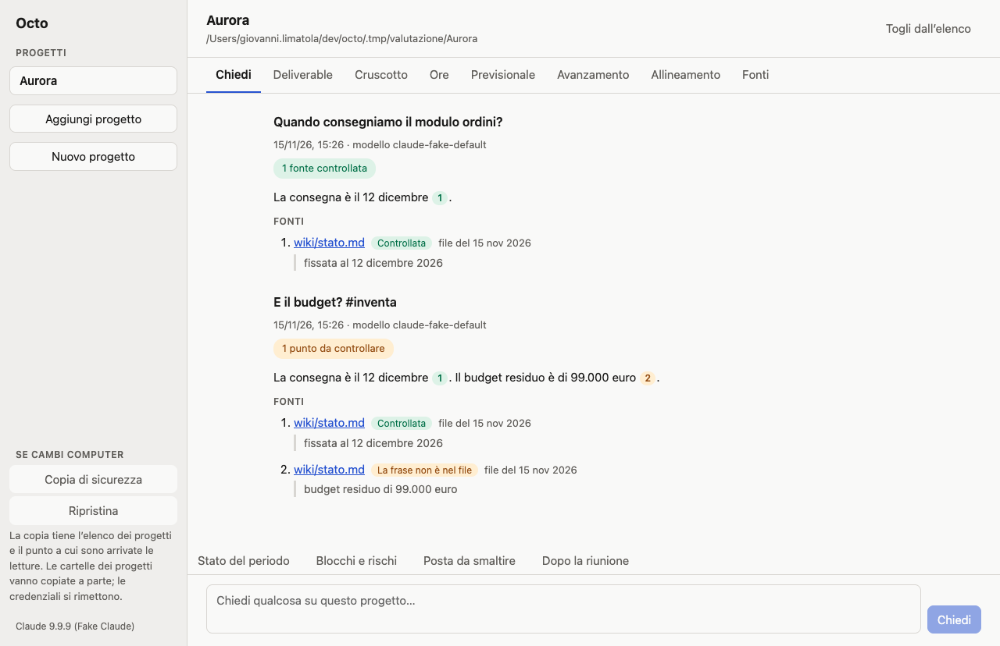
- Dove: barra laterale (`App.tsx:112-158`). Il progetto attivo è un riquadro bianco bordato; subito sotto, «Aggiungi progetto» e «Nuovo progetto» sono riquadri bianchi bordati identici. Tre pulsanti uguali in colonna: il primo è «dove sei», gli altri due sono azioni.
- Perché ostacola: con un solo progetto niente dice che lì si cambia progetto; con più progetti la lista e le azioni si confondono. Il nome del progetto è poi ripetuto in testata, che sembra il posto «giusto» dove agire sul progetto, e lì c'è solo «Togli dall'elenco».
- Cosa farei: §3.1.

**«Aggiungi progetto» e «Nuovo progetto» non si distinguono.** Il primo collega una cartella che esiste, il secondo ne crea una. Dalle etichette non si capisce. Proposta: un solo pulsante «Aggiungi un progetto…» che apre due scelte spiegate: «Ho già una cartella» e «Parto da zero (Octo crea la cartella)».

**«Nuovo progetto» apre un modulo dentro la barra laterale**, con un campo non stilato largo 150 px e nessun modo di annullare. 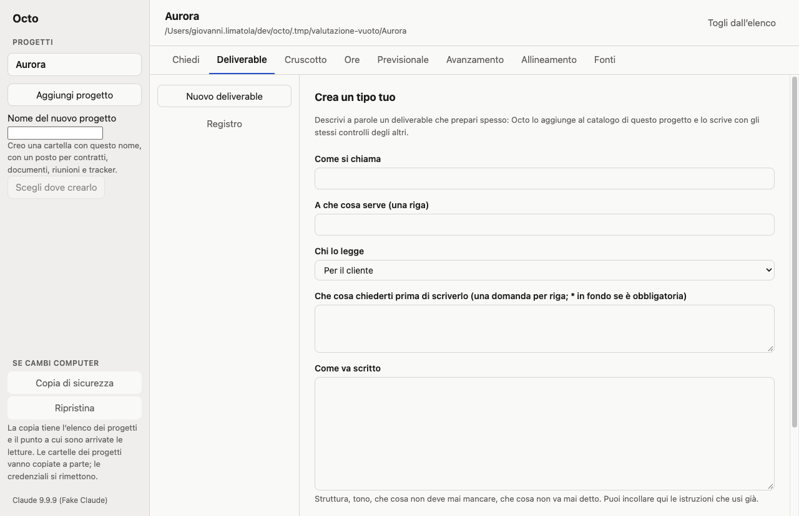 Proposta: dentro lo stesso dialogo di cui sopra, con «Annulla».

**Otto schede sullo stesso piano.** Chiedi e Deliverable si usano ogni giorno; Cruscotto ogni settimana; Ore, Previsionale, Avanzamento una volta al mese; Allineamento a ogni sprint; Fonti quasi solo all'inizio. Oggi hanno lo stesso peso, e a 900 px l'ultima («Fonti», quella da cui parte un progetto nuovo) esce dalla finestra (§2.5). Proposta e scelta in §3.2.

**Le impostazioni stanno in fondo alla pagina, dopo i risultati**, in un `details` con la freccia del browser. In Previsionale si arriva alle impostazioni dopo 2.300 px. E quando una scheda non è configurata, lo stesso modulo occupa tutta la pagina con un altro titolo («Da dove leggo le ore» / «Impostazioni delle ore»). Proposta: in ogni scheda un pulsante «Impostazioni» in alto a destra, sempre nello stesso posto, che apre lo stesso pannello.

**Le schede rimandano l'una all'altra senza collegamento.** «…indicati in «Fonti»», «Indica prima, nella scheda «Ore», dove sono i timesheet», «…qui o nella scheda «Cruscotto»». Il PM deve ricordare, cambiare scheda e trovare la sezione. Proposta: ogni rimando è un pulsante che porta alla sezione giusta.

**Giusto così:** l'apertura su «Fonti» di un progetto appena aggiunto; la guida «Avvio del progetto» come elenco e non come procedura obbligata.

### 2.2 Moduli

**Campi a righe con separatori.** Sono una quindicina (elenco in §5). Esempi:
- Avanzamento: «Posizioni dell'ordine: una riga per posizione, «codice; importo»»; «Che cosa va in ogni cella: una riga per cella, «cella = testo»»; «Tabella delle posizioni: «prima riga; numero di righe; colonna posizione; precedente; attuale; di periodo»» con valore `8; 6; A; B; C; D`.
- Previsionale: «nome; tariffa» oppure «nome; commessa; tariffa»; «nome; commessa; costo al giorno; tariffa al giorno».
- Fonti: «nome; ruolo; nostra o cliente; dal; al; come scrivergli».
- Allineamento: «nome: stati del cliente = stati dei ticket».

Tre separatori diversi (`;`, `=`, `:`), più virgola e a capo per le liste. Perché ostacola: è un formato da programmatori; la posizione dei valori va ricordata; un errore non si vede. Cosa farei: una tabella modificabile (una riga per elemento, una colonna per valore, «Aggiungi riga», «Togli»), con il tipo giusto in ogni colonna. È lo stesso componente per tutti i casi.

**Righe non capite: scartate in silenzio, con conferma verde.** Verificato nell'app:
- Persone: ho scritto `Mario Rossi; sviluppatore; boh; 32/13/2026`. Dopo «Salva» il campo dice `Mario Rossi; sviluppatore; nostra; 32/13/2026; ; `: «boh» è diventato «nostra» e la data impossibile è rimasta. Calendario `Sprint 1; ieri; domani`: la riga è sparita. Messaggio: «Salvate 1 persone e 0 periodi.» in verde. 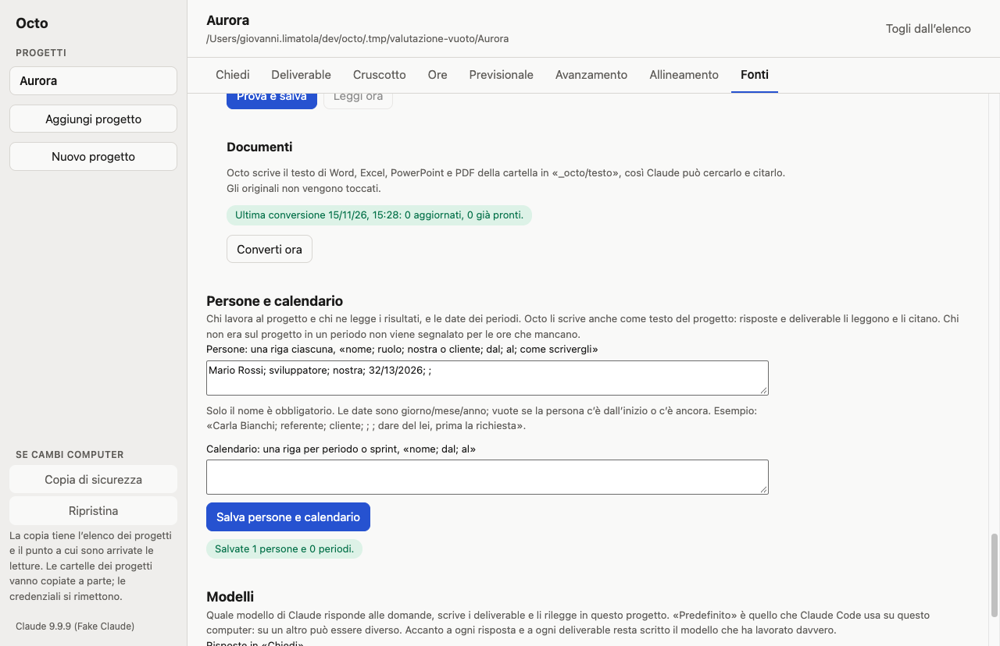
- Avanzamento: posizioni `00001; 1000`, `pippo`, `00002; mille`. Le ultime due spariscono; l'unico errore mostrato riguarda il totale, calcolato su 1.000.
- Dal codice (non provato a schermo): lo stesso accade per tariffe, esterni, nomi diversi della stessa persona e gruppi di stati (`aliasesOf` in `HoursView.tsx:372`, `ratesOf`, `stateGroupsOf`).

Perché ostacola: su Previsionale e Avanzamento vuol dire cifre sbagliate mandate all'amministrazione o al cliente senza che nulla lo segnali. Cosa farei subito, anche prima delle tabelle: salvare solo se ogni riga è capita; altrimenti dire «Riga 2: «pippo» non è «codice; importo»» accanto al campo.

**Percorsi di file scritti a mano.** «File dell'esportazione», «Modello: file Excel nella cartella del progetto», «Modulo vuoto», «Timesheet: file o cartella». Octo propone il file se ne trova uno solo, altrimenti un `datalist` che non si vede finché non si scrive; se non trova nulla dice «scrivi il percorso a mano». 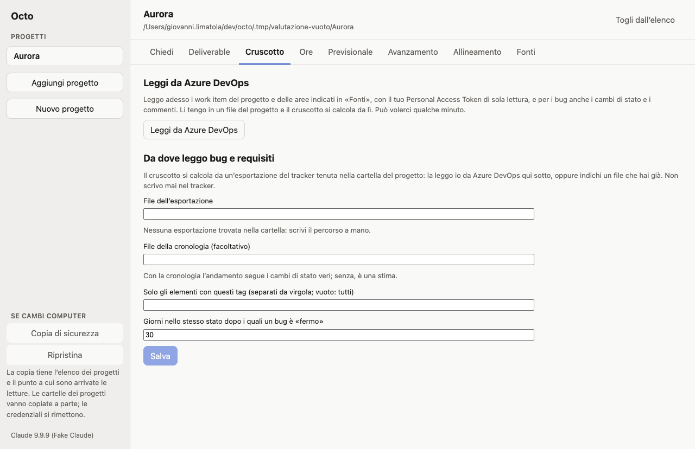 Un PM non scrive percorsi. Cosa farei: un pulsante «Scegli il file…» con la finestra del sistema (come già fanno carta intestata e modello delle presentazioni), e il nome del file scelto mostrato accanto.

**Valori noti riscritti a mano.** Tag, sprint, periodi, persone, codici commessa, stati: Octo li ha già letti dal tracker, dai timesheet o da «Fonti», e li fa riscrivere separati da virgola. Elenco in §5. Giusto così, e da estendere: le caselle di spunta per periodi e stati nel Cruscotto (`DashboardSettingsForm.tsx:97-118`) e i suggerimenti «Cerca progetti e aree» per Azure DevOps e Jira.

**Etichette che fanno da manuale.** «Ultimo giorno completo (i giorni dopo restano fuori dal confronto; vuoto: nessuno)», «Solo su queste posizioni (separate da virgola; vuoto: a partire dalla prima)». L'etichetta dovrebbe essere il nome del campo («Ultimo giorno completo»); il resto è un aiuto sotto il campo, e «vuoto: …» è il testo grigio dentro il campo vuoto.

**Importi come testo libero.** «Totale dichiarato dall'ordine» accetta qualunque testo; la demo scrive `340.000`, il campo rilegge `340000`. Cosa farei: campo importo allineato a destra, con «€», che riformatta all'uscita (`340.000,00`) e rifiuta ciò che non è un numero.

**Campi tecnici in primo piano.** «Cartella nel progetto» (`_octo/fonti/ADO`) compare in ogni fonte, con un valore che il PM non ha motivo di cambiare; «Porta», «Database», «Sicurezza della connessione» per NetSuite. Cosa farei: sotto «Avanzate», chiuso.

**Obbligatorio e facoltativo non si distinguono.** Solo «File della cronologia (facoltativo)» lo dice. Il pulsante «Salva» disattivato (Cruscotto, Ore, Previsionale, Allineamento) non spiega che cosa manca. Cosa farei: segnare i facoltativi, tenere «Salva» attivo e dire al clic quale campo manca.

### 2.3 Riscontri: caricamento, errore, successo

**Avvisi che non si chiudono.** Il riquadro del ripristino («Ripristinati: Aurora. Rimetti le credenziali…») resta in cima a tutte le schede finché non si chiude l'app o si fa un'altra copia (`App.tsx:177-183`: `backupNotes` si azzera solo lì). A 1280×860 toglie 220 px a ogni pagina; a 900×600 ne occupa metà. 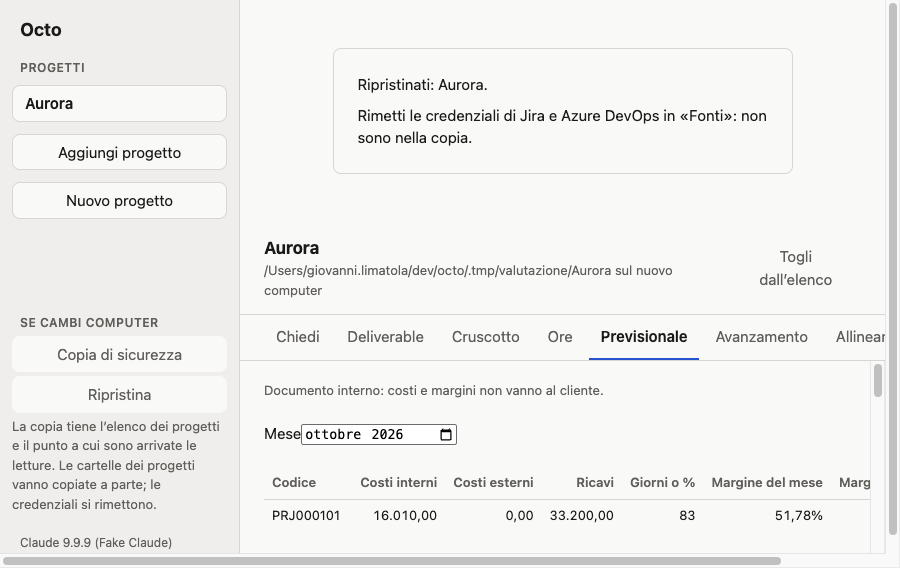 Lo stesso vale per l'errore generale in testata. Cosa farei: ogni avviso ha una «×»; le conferme spariscono da sole dopo qualche secondo o al cambio di scheda.

**Errori generici o fuorvianti.** Verificati nell'app:
- Jira con il modulo vuoto, «Prova e salva»: «Controlla il giorno di inizio e la cartella: uno dei due non è valido.» Giorno e cartella sono gli unici due campi compilati; mancano sito, email e progetti. 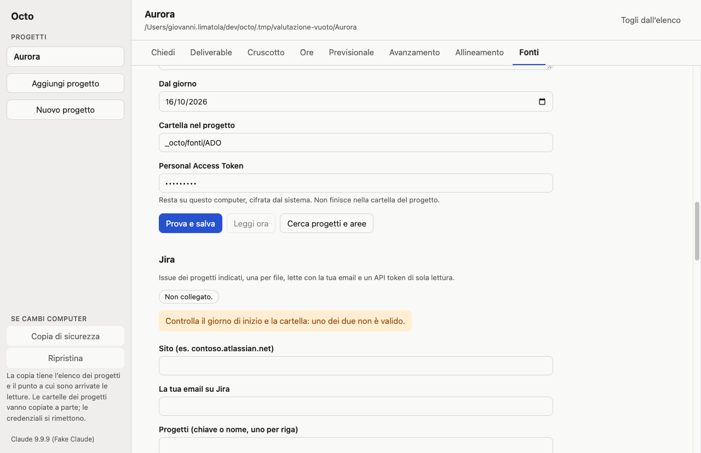
- Ore, «Leggi i timesheet da NetSuite» senza fonte: «Questa fonte non è ancora configurata.» Non dice quale fonte né dove andare. 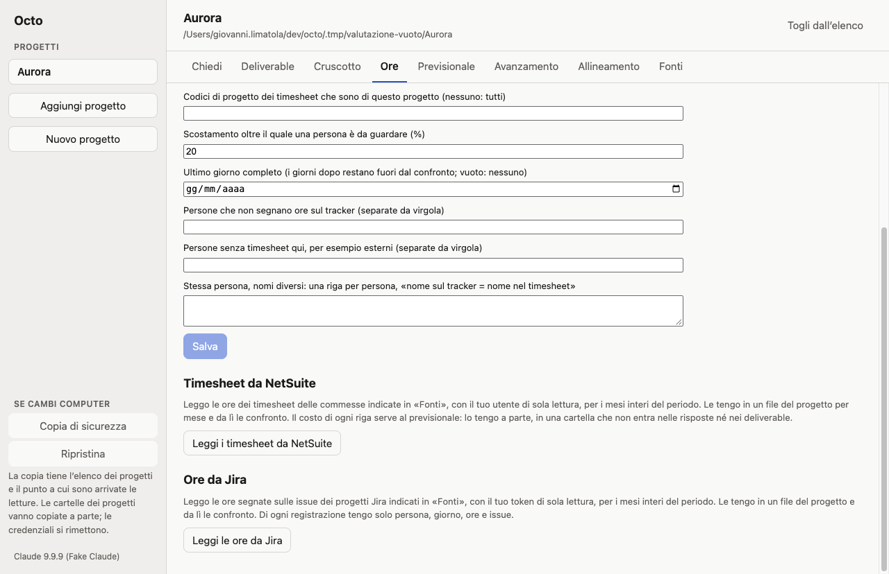 Identico in Cruscotto con «Leggi da Azure DevOps». 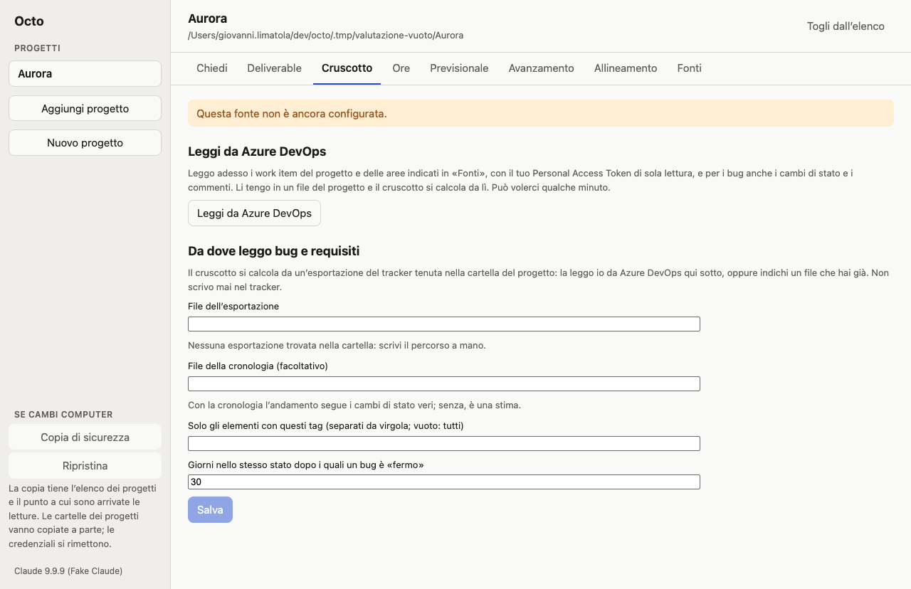
- Avanzamento: «Le percentuali non si possono calcolare, o le posizioni sono più delle righe della tabella del modulo»: due cause diverse in un messaggio.
- «Qualcosa non ha funzionato. Riprova.» per ogni caso non previsto.

Cosa farei: ogni errore dice che cosa manca e offre l'azione («NetSuite non è collegato. → Collega NetSuite»). I pulsanti che dipendono da una fonte non collegata lo dicono prima del clic.

**Errori lontani dal campo.** Tutti gli errori sono una riga in cima alla scheda o alla sezione. In Avanzamento, dopo un salvataggio con errori, il modulo si richiude: restano tre righe arancioni e «▶ Ordine e richieste» chiuso. 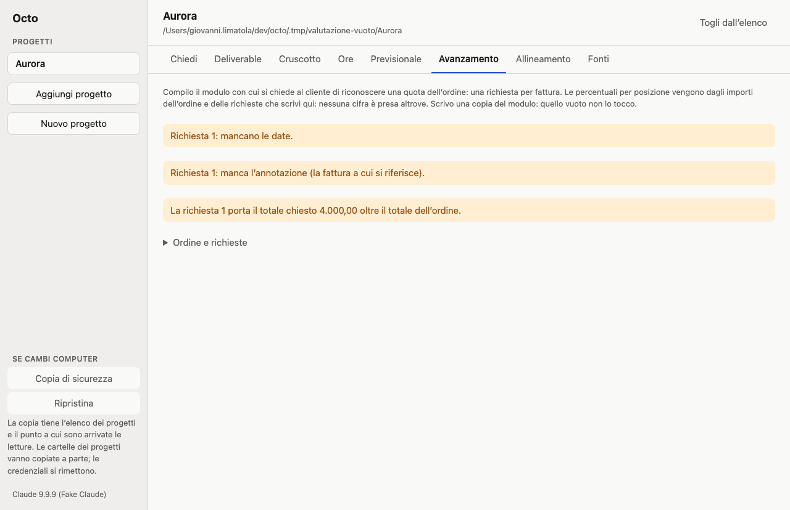 Il PM deve riaprire e cercare la «Richiesta 1». Cosa farei: l'errore accanto al campo, il modulo resta aperto, il primo campo sbagliato prende il fuoco.

**Avvisi ed errori hanno lo stesso aspetto.** «Mancano le date» (si può proseguire) e «porta il totale oltre l'ordine» (blocca) sono due strisce arancioni identiche. Non esiste un colore di errore: in `styles.css` c'è solo `--warning`. Anche «Grave» nella rilettura critica è arancione come «Media».

**Salvataggi senza conferma.** In Cruscotto, Ore, Previsionale, Avanzamento e Allineamento «Salva» non dice nulla: la pagina si ridisegna. In Posta e nelle fonti compare «Salvato…» in grigio accanto ai pulsanti; in Persone e Modelli una pillola verde. Tre modi diversi. Cosa farei: una sola conferma, sempre nello stesso posto, accanto al pulsante premuto.

**Operazioni lunghe.** Il testo «Sto leggendo…» in grigio è l'unico segnale, senza animazione; durante una lettura i pulsanti della sezione si disattivano, ma niente dice quanto manca né permette di fermare (solo «Chiedi» ha «Ferma»). «Leggi da Azure DevOps» avvisa «Può volerci qualche minuto» e poi non mostra avanzamento. La scrittura di un deliverable dura minuti con una sola riga fissa. Con il Claude finto delle demo queste attese durano un istante: come si vivono davvero non l'ho potuto vedere (§8). Cosa farei: un indicatore animato comune, i passi man mano (come già fa «Riempi la memoria ora», che è giusto), e «Ferma» dove l'operazione supera qualche secondo.

**Stati vuoti.** Chiedi e Deliverable hanno una frase che dice che cosa fare: giusto. Cruscotto, Ore, Previsionale, Avanzamento e Allineamento vuoti mostrano direttamente il modulo di configurazione, senza dire che cosa si otterrà né quale sia il primo passo. Cosa farei: una riga «Che cosa ottieni» e un'azione principale sola («Leggi da Azure DevOps», «Scegli il modello Excel»), con il resto sotto «Altre impostazioni».

### 2.4 Testi

**Giusto così:** l'italiano è semplice e diretto, il tono è costante («Leggo…», «Non scrivo in nessun sistema»), le spiegazioni di ciò che Octo non tocca rassicurano. «deliverable» e «istruzioni» sono usate come da roadmap, e nessun testo usa la parola che la roadmap esclude.

Da correggere:
- **Gergo tecnico in vista.** «(JSON)», «(CSV)» nelle etichette di Ore; «data warehouse», «NetSuite (DWSI)», «Personal Access Token (Work Items: Read, Project and Team: Read)», «API token» in Fonti; `_octo/testo`, `_octo/fonti/ADO` in chiaro; «Il codice ha trovato giornate di lavoro o importi» nella revisione di un deliverable (per un PM «il codice» è Octo); «work item», «issue», «worklog» nei messaggi d'errore («ore del tracker (file .csv)»).
- **Lo stesso oggetto con nomi diversi.** Codice di progetto / codice commessa / commessa / «PRJ»; esportazione / file dell'esportazione / tracker letto; voce / work item / elemento; ticket / issue; periodo / sprint / periodo di pianificazione; modello (file Excel) / modello (di Claude) / modulo. Serve un piccolo glossario e una passata su `messages.ts`.
- **«Modello» ha due significati** nella stessa app: il file dell'amministrazione e il modello di Claude. In Previsionale «Compila il modello»; in Fonti «Modelli». Proposta: «modello Excel» sempre per esteso; la sezione dei modelli di Claude diventa «Quale Claude lavora».
- **Titoli che non dicono che cosa fa la scheda.** «Avanzamento» (di che cosa? esiste già il deliverable «Stato di avanzamento»), «Allineamento», «Fonti» (che contiene anche persone, calendario e modelli). Proposta: «Richieste al cliente (SAL)» o «Modulo di avanzamento»; «Confronto fra tracker»; «Impostazioni del progetto».
- **«Togli dall'elenco»**: la spiegazione («La cartella resta dov'è: Octo smette solo di mostrarla») compare solo fermando il mouse, ed è incompleta: non dice che si perdono le letture e che le credenziali vanno rimesse.
- **Plurali.** «Salvate 1 persone e 1 periodi.»
- **Titolo della barra «Se cambi computer»**: è un'eventualità rara e occupa un quinto della barra, con un paragrafo sempre visibile.
- **Versione di Claude in fondo alla barra** («Claude 9.9.9»): informazione per chi sviluppa; a un PM serve solo sapere se Claude manca, e quello è già detto bene.

### 2.5 Grafica

**Due stili di modulo.** Posta, Azure DevOps, Jira, NetSuite e «Crea un tipo tuo» usano `.source-form`: etichetta in grassetto, campi alti 36 px con bordo arrotondato. Tutto il resto (Cruscotto, Ore, Previsionale, Avanzamento, Allineamento, Persone, Modelli) usa `.settings-form`, che non stila i campi: restano quelli del browser, alti 20 px, bordo nero squadrato, carattere più piccolo. Nella pagina Fonti i due stili si vedono uno sopra l'altro, con rientri diversi. 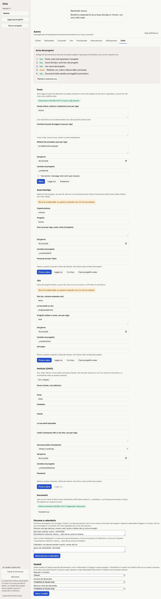 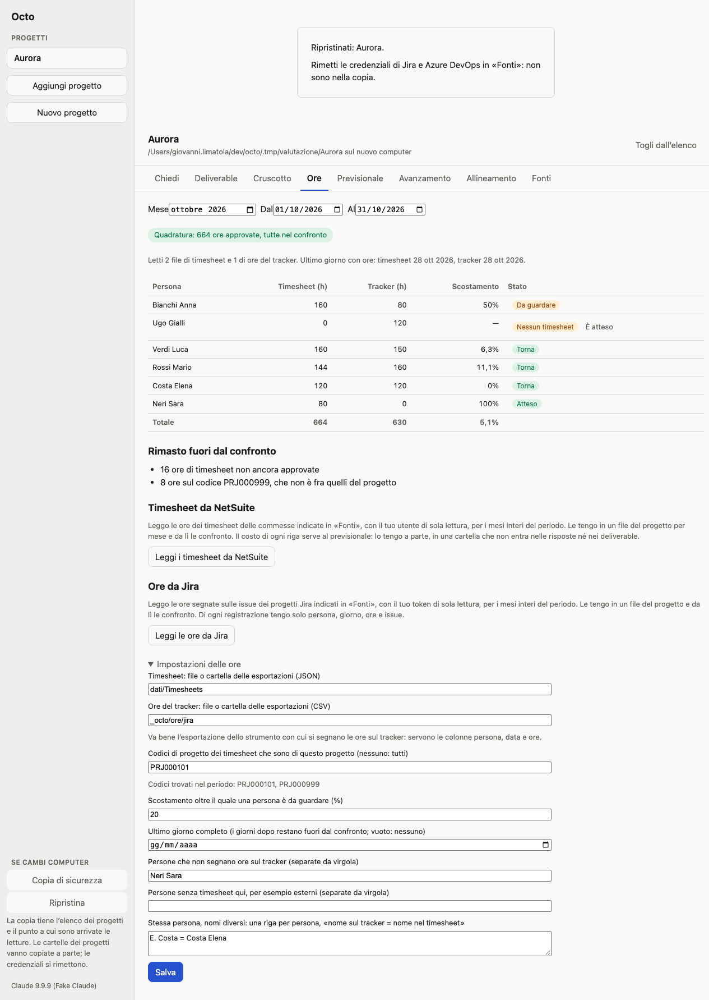 È la causa principale dell'aspetto grezzo e costa poco: sono regole CSS.

**Nessuna gerarchia fra i pulsanti.** L'azione principale di una scheda spesso è un pulsante bianco bordato come gli altri: «Compila il modulo della richiesta 1», «Compila il modello», «Leggi da Azure DevOps», «Riempi la memoria ora», «Scrivi il file di import». Il blu pieno è riservato a «Salva» (regola CSS su `button[type="submit"]`), cioè all'azione meno importante. I pulsanti «quieti» («Togli la richiesta 1», «Aggiungi una richiesta», «Scollega», «È atteso», «Apri il file») sono testo grigio senza bordo: non sembrano pulsanti. Proposta in §6.

**Etichette attaccate ai campi.** «Mese[ottobre 2026]», «Dal[01/10/2026]», «Al[31/10/2026]» in Ore e Previsionale: nessuno spazio fra etichetta e campo.

**Larghezze senza regola.** I moduli sono larghi 720 px, le tabelle tutta la finestra, i testi introduttivi tutta la finestra (righe di 180 caratteri), la conversazione 820 px centrata, Fonti rientrata di 26 px in più. Il margine sinistro cambia da sezione a sezione nella stessa pagina.

**Titoli tutti uguali.** Ogni sezione ha un titolo da 17 px in grassetto e un paragrafo grigio da 13 px: «Richiesta 1», «Rimasto fuori dal confronto», «Timesheet da NetSuite» hanno lo stesso peso, risultati e strumenti non si distinguono. In Allineamento sette tabelle una sotto l'altra con sette titoli identici. 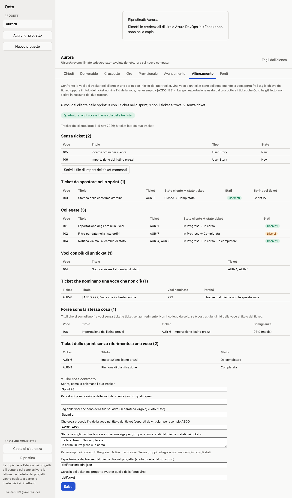

**Tabelle.** Leggibili, numeri allineati a destra: giusto. Mancano: intestazione che resta visibile scorrendo, evidenza della riga sotto il mouse, righe che richiedono attenzione distinte dalle altre (in Ore «Da guardare» è una pillola nell'ultima colonna, la riga è uguale alle altre). In Previsionale nove colonne: a 900 px la tabella esce dalla finestra.

**Finestra minima 900×600.** 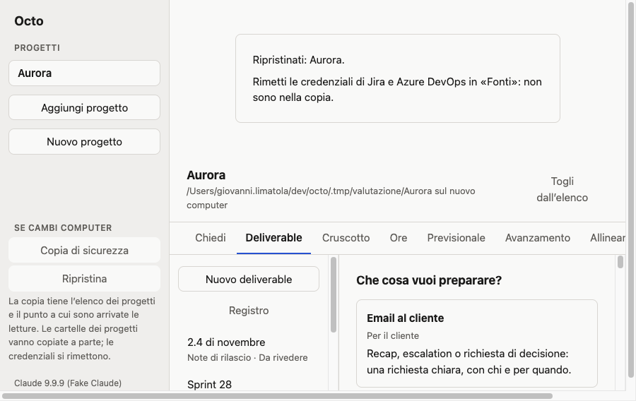
- La barra delle schede si taglia a «Allinear…»: «Fonti» non si vede e non c'è segno che si possa scorrere.
- Compare una barra di scorrimento orizzontale su tutta la finestra.
- «Togli dall'elenco» va a capo su due righe.
- La barra laterale tiene 240 px fissi: restano 660 px al contenuto; in Deliverable l'elenco ne prende altri 240 e il catalogo passa a una colonna.
Cosa farei: barra laterale richiudibile o a 200 px sotto i 1100; schede che vanno a capo o menu «Altro»; minimo portato a 1024×640 se accettabile.

**Densità.** A 1280×860 la barra laterale è per due terzi vuota e per un quinto occupata da «Se cambi computer»; la testata con percorso completo della cartella e la riga delle schede prendono 120 px. In Avanzamento una richiesta con quattro posizioni occupa 350 px: se ne vedono due per finestra.

**Tema scuro.** Esiste nel CSS; non l'ho guardato (§8). Dal calcolo: testo bianco su pulsante `#8da2fb` ha contrasto 2,4:1, insufficiente.

### 2.6 Accessibilità di base

- **Etichette:** ogni campo ha la sua (0 campi senza nome nella pagina Fonti). Giusto.
- **Fuoco:** pulsanti e aree di testo hanno un contorno blu di 2 px; campi a riga singola, date, caselle e menu hanno quello predefinito del browser (arancione, 1 px): due aspetti diversi nello stesso modulo. 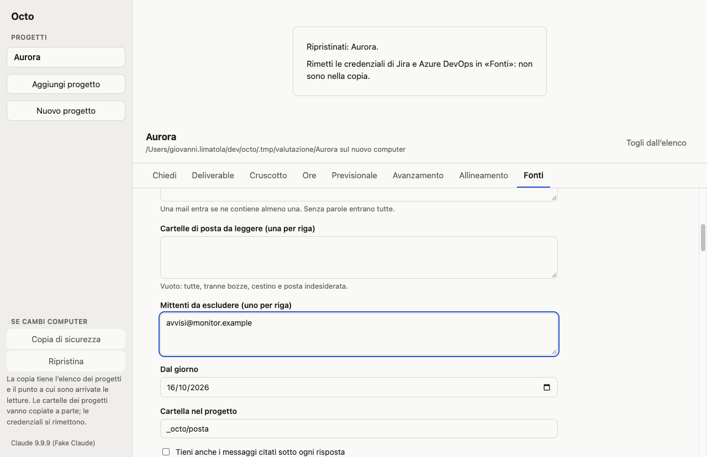 La regola è in `styles.css:73-78` e nomina solo `button`, `textarea`, `a`.
- **Tastiera:** tutto è raggiungibile con Tab. Le schede hanno `role="tab"` ma le frecce non le scorrono (verificato) e manca il pannello collegato; un campo data chiede quattro Tab. Nessuna scorciatoia per cambiare scheda o progetto.
- **Spiegazioni solo al passaggio del mouse** (`title`): «Togli dall'elenco», «È atteso», le domande pronte, la descrizione del codice in Previsionale. Da tastiera non si leggono.
- **Contrasto** (calcolato sui colori di `styles.css`, tema chiaro): testo grigio su fondo 5,2:1, su barra laterale 4,8:1; arancione e verde sulle loro pillole 4,8:1 e 4,7:1; bianco sul blu 5,7:1: sufficienti, ma i testi grigi sono a 12–13 px e sono moltissimi. Pulsante disattivato: 2,2:1, quasi illeggibile, ed è proprio «Salva». Bordo dei campi su fondo 1,3:1: i campi stilati si distinguono a fatica dal fondo.
- **Stato detto solo dal colore:** no, le pillole hanno sempre il testo. Giusto.
- Non verificato con un lettore di schermo (§8).

### 2.7 Azioni distruttive o irreversibili

| Azione | Dove | Oggi | Giudizio |
|---|---|---|---|
| Togli dall'elenco | testata | un clic, nessuna conferma, nessun ritorno; cancella lo stato delle letture; credenziali e indici restano sul disco, legati a un identificativo che non tornerà | da spostare e rendere reversibile (§3.1) |
| Scollega (fonte) | Fonti | un clic, nessuna conferma; pulsante grigio accanto a «Leggi ora» | chiedere conferma dicendo che cosa succede a file letti e credenziale. Effetto sui file non provato (§8) |
| Elimina (tipo di deliverable tuo) | Deliverable | un clic, nessuna conferma (`DeliverablesView.tsx:222`) | conferma; le istruzioni scritte dal PM sono lavoro |
| Togli la richiesta N | Avanzamento | toglie dal modulo; vale solo al «Salva»; le richieste dopo si rinumerano | chiaro a metà: dire che le successive cambiano numero, e che i moduli già compilati restano con il numero vecchio |
| Togli (carta intestata, modello presentazioni) | Deliverable | un clic | accettabile: si rimette scegliendo il file |
| Cambiare progetto, aree o codici di una fonte | Fonti | al salvataggio toglie i file letti e riparte (roadmap) | l'interfaccia non lo dice: avvisare prima di salvare |
| È atteso / È chiaro / Togli segnale | Ore, Cruscotto | un clic, effetto permanente; «È atteso» si annulla solo cancellando il nome da un campo di testo nelle impostazioni | serve «Annulla» subito dopo e un elenco da cui togliere |
| Approva (deliverable) | Deliverable | un clic, scrive i file | giusto: è l'esito voluto e i file si rigenerano |

---

## 3. Navigazione e progetti: proposta

### 3.1 Cambio progetto: flusso ridisegnato

**Che cosa succede oggi con «Togli dall'elenco»** (verificato nell'app e in `packages/application/src/projects.ts:65-70`):
1. Un clic in testata: il progetto sparisce, senza conferma. Se era l'unico, resta «Nessun progetto». 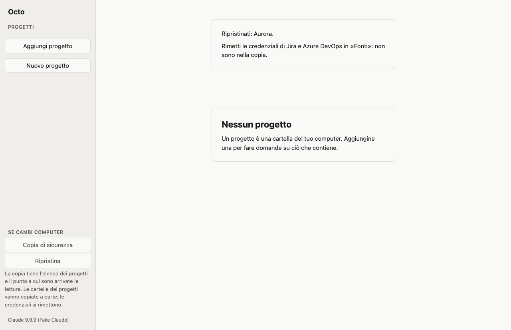
2. Octo cancella lo stato delle letture (ultima lettura e punto raggiunto di posta e sistemi).
3. Le credenziali e gli indici di lettura restano nella cartella dati, legati all'identificativo del progetto.
4. Riaggiungendo la stessa cartella il progetto riceve un identificativo nuovo: la guida dice ancora «fatto» per Azure DevOps e Jira (le impostazioni stanno nella cartella), ma ogni fonte mostra «Serve la credenziale: su questo computer non ce n'è una salvata» e le letture ripartono da capo. Le credenziali vecchie restano sul disco, inutili e mai cancellate.

**Flusso proposto.**

1. **In cima alla barra laterale, al posto del titolo «Progetti», un selettore**: il nome del progetto attivo con una freccia, grande quanto la barra. È l'unico controllo con quell'aspetto.
2. **Clic sul selettore: si apre l'elenco** dei progetti, con il nome, sotto il nome l'ultima lettura («letto 10 minuti fa», «da leggere»), una spunta su quello attivo. In fondo all'elenco, separate da una riga: «Aggiungi un progetto…» e «Gestisci i progetti…».
3. **Clic su un progetto: si passa a quello**, sulla stessa scheda in cui si era (oggi la scheda resta, bene). L'elenco si chiude.
4. **Da tastiera:** ⌘/Ctrl+1…9 per i primi nove progetti; nell'elenco frecce e Invio.
5. **«Aggiungi un progetto…»** apre un dialogo con due scelte spiegate: «Ho già una cartella» (finestra del sistema) e «Parto da zero» (nome, poi dove crearla). «Annulla» sempre presente.
6. **«Gestisci i progetti…»** apre un dialogo con una riga per progetto: nome, cartella, e a destra «Apri la cartella» e «Togli da Octo». Qui vanno anche «Copia di sicurezza» e «Ripristina», con la loro spiegazione: la barra laterale si libera.
7. **«Togli da Octo»** chiede conferma: «Tolgo «Aurora» da Octo? La cartella e tutto ciò che contiene restano dove sono. Su questo computer [tengo / cancello] le credenziali e il punto a cui sono arrivate le letture.» Pulsanti «Annulla» e «Togli».
8. **Dopo aver tolto**, una riga in basso per qualche secondo: «Aurora tolto. Annulla».
9. **In testata resta solo** il nome del progetto e, a destra, l'età dei dati («Fonti lette 10 minuti fa · Leggi ora»): è l'informazione che serve a ogni apertura e oggi sta in fondo a Fonti.

**Scelta tua: che cosa fa «Togli».**
- **A (raccomandata): reversibile.** Togliere nasconde il progetto; credenziali e letture restano e tornano se si riaggiunge la stessa cartella. Richiede che il progetto si riconosca dalla cartella e non da un identificativo nuovo (modifica fuori dall'interfaccia, piccola).
- **B: definitiva e pulita.** Togliere cancella anche credenziali e indici, e lo dice. Più semplice, ma chi toglie per errore rifà tutto.
- Oggi non è né A né B: perde le letture e lascia le credenziali sul disco.

### 3.2 Scelta tua: come raggruppare le schede

Oggi: otto schede in riga, sullo stesso piano.

- **A (raccomandata): navigazione nella barra laterale, a gruppi.** Sotto il selettore del progetto:
  - *Lavoro*: Chiedi, Deliverable, Cruscotto.
  - *Ogni mese*: Ore, Previsionale, Modulo di avanzamento.
  - *Ogni sprint*: Confronto fra tracker.
  - in fondo, staccato: *Impostazioni del progetto*.

  Vantaggi: la barra laterale, oggi quasi vuota, serve a qualcosa; la riga delle schede sparisce e libera 50 px; a 900 px niente si taglia; c'è posto per altre voci. Costo: medio, quasi tutto in `App.tsx` e `styles.css`.
- **B: lasciare le schede, separare la configurazione.** Sette schede di lavoro e, a destra staccata, un'icona «Impostazioni». Costo piccolo, ma a 900 px le schede continuano a non starci.
- **C: accorpare.** Ore + Previsionale + Avanzamento in una scheda «Economia» con tre sottoschede. Non lo raccomando: sono tre lavori con fonti e tempi diversi, e si aggiungerebbe un livello senza togliere nulla.

**Scelta tua: Allineamento.** Serve solo a chi ha due tracker. Raccomando di mostrarlo solo se il progetto ha sia un'esportazione del cliente sia Jira collegato, altrimenti una riga in Impostazioni («Hai due tracker? Attiva il confronto»). Alternativa: lasciarlo sempre visibile.

**Scelta tua: «Modelli» (quale Claude lavora).** Raccomando di toglierlo dalla pagina di ogni progetto e metterlo in «Avanzate»: il predefinito va bene quasi sempre e la sezione oggi pesa quanto Posta. Alternativa: lasciarlo, ma chiuso.

---

## 4. Scheda per scheda

### 4.1 Aggiungere un progetto e collegare le fonti (Fonti)

**Percorso di un PM alla prima volta.** «Aggiungi progetto» → finestra del sistema → si apre Fonti. Poi: leggere la guida, scendere a Posta (5 campi), scendere ad Azure DevOps (6 campi), Jira (6), NetSuite (10), Documenti, Persone e calendario, Modelli. In tutto circa 35 campi su 4.684 px, poi tornare in cima per «Riempi la memoria ora».

**Che cosa non funziona.**
- **La guida elenca i passi ma non ci porta.** «da fare — Jira: issue del progetto» è testo: per farlo bisogna scorrere e trovare la sezione. I passi sono numerati 1–5 ma l'ordine non conta.
- **Sette sezioni aperte insieme**, tutte con il modulo completo anche se già collegate. Una fonte collegata e funzionante mostra gli stessi sei campi di una da collegare.
- **«Riempi la memoria ora» è attivo anche senza nulla collegato**, e sta sopra le sezioni che vanno compilate prima.
- **Quattro pulsanti per fonte sulla stessa riga**: «Prova e salva», «Leggi ora», «Scollega», «Cerca progetti e aree». L'ordine giusto è: token → «Cerca progetti e aree» → scegliere → «Prova e salva» → «Leggi ora». Il pulsante da premere per primo è l'ultimo a destra, e i risultati della ricerca compaiono sotto tutto il modulo.
- **Dove si prende il token non è detto.** «Personal Access Token di sola lettura (Work Items: Read, Project and Team: Read)» presuppone che il PM sappia crearlo. È il punto in cui un PM non tecnico si ferma.
- **Posta:** «Leggi ora» e «Anteprima» accanto a «Salva» senza dire che l'anteprima usa ciò che è scritto e la lettura ciò che è salvato. L'anteprima è un'ottima idea: va resa il passo naturale prima di salvare.
- **NetSuite:** dieci campi tecnici; «Server (nome, non indirizzo)», «Database», «Utente» sono uguali per tutti i PM dell'azienda.
- **Persone e calendario:** due aree di testo con sei valori per riga separati da `;` (§2.2). Non ha niente a che fare con le «fonti».
- **Errori:** vedi §2.3 (Jira vuoto).

**Proposta.**
1. La pagina diventa «Impostazioni del progetto», con un elenco a sinistra (o sottoschede): *Fonti*, *Persone e calendario*, *Avanzate*.
2. *Fonti* è un elenco di cinque righe, una per fonte: nome, stato («Collegata · letta 10 minuti fa · 42 elementi» / «Da collegare» / «Errore: credenziale rifiutata»), e un pulsante («Collega», «Modifica», «Leggi ora»). È la guida di oggi, resa cliccabile, e sostituisce le sette sezioni impilate.
3. «Collega» apre la fonte da sola, a passi: (1) credenziale, con «Come ottengo il token?» che apre tre righe di spiegazione e il collegamento alla pagina giusta; (2) «Cerca» e scelta di progetto e aree da un elenco con caselle; (3) «Prova e salva», che alla riuscita lancia la prima lettura.
4. «Scollega» sta dentro «Modifica», con conferma.
5. «Leggi tutto ora» in cima all'elenco, attivo solo se almeno una fonte è collegata.
6. NetSuite: server, porta, database e sicurezza con i valori dell'azienda già scritti, sotto «Avanzate»; in vista restano utente, password e codici commessa.

### 4.2 Chiedi

**Giusto così:** domanda, risposta, fonti controllate una per una con la frase citata; lo stato di ogni fonte a parole; «Ferma»; le domande pronte che riempiono senza inviare.

**Da sistemare.**
- Le domande pronte sono testo grigio senza bordo sopra il riquadro: sembrano etichette. Renderle pillole cliccabili.
- «15/11/26, 15:25 · modello claude-fake-default» sotto ogni domanda: il modello è rumore per un PM; tenerlo al passaggio del mouse o in un dettaglio.
- «Chiedi» disattivato a campo vuoto è azzurro sbiadito: sembra un pulsante rotto.
- Nessuna indicazione dell'età delle fonti prima di chiedere (è la cosa che decide se fidarsi della risposta): una riga sopra il riquadro, «Posta letta 10 min fa · Azure DevOps 2 giorni fa».
- La cronologia è un'unica colonna senza modo di cercare o ripartire da capo: con settimane di domande diventa lunga. Giudizio dato dal codice: con i dati delle demo non si vede.
- Stato «in corso»: una riga grigia con il passo («Leggo wiki/stato.md»). Va bene come contenuto, manca un segno animato.

### 4.3 Deliverable

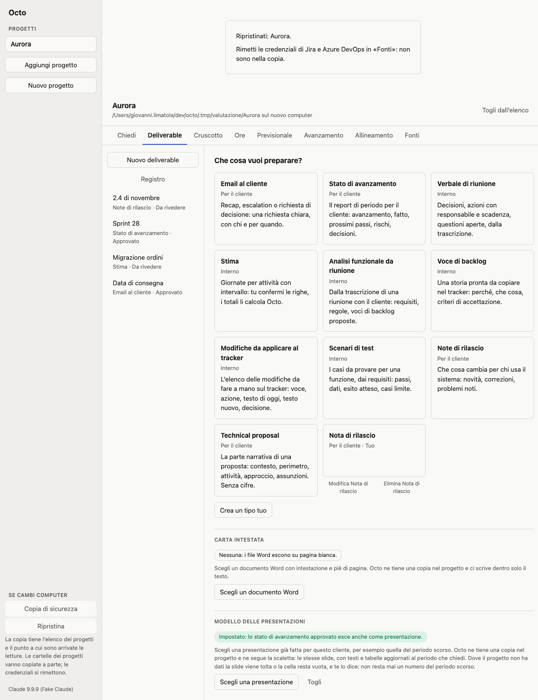 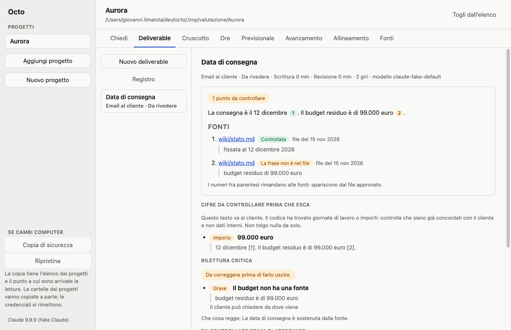

**Giusto così:** il catalogo a riquadri con «Per il cliente / Interno»; la revisione con fonti, cifre da controllare, rilettura critica ed elenco di controllo prima di «Approva»; la modifica a parole.

**Da sistemare.**
- **Undici tipi senza ordine né ricerca**, più quelli del PM. I quattro più usati (email, stato di avanzamento, verbale, stima) dovrebbero stare in una prima riga «Più usati».
- **«Carta intestata» e «Modello delle presentazioni» sono in fondo al catalogo**: sono impostazioni fatte una volta e compaiono a ogni nuovo deliverable. Spostarle in Impostazioni del progetto.
- **Il tipo del PM** («Nota di rilascio · Tuo») è un riquadro vuoto più basso degli altri, con «Modifica Nota di rilascio» ed «Elimina Nota di rilascio» in grigio sotto, fuori dal riquadro, su due righe. «Elimina» senza conferma.
- **«Registro» è un pulsante grigio** sopra l'elenco: non sembra una voce.
- **L'elenco a sinistra** non distingue a colpo d'occhio «Da rivedere» da «Approvato»: stesso grigio. Una pillola colorata, come altrove.
- **La pagina di revisione è lunga**: bozza, fonti, cifre, rilettura, elenco di controllo, modifica, «Approva» in fondo. «Approva» e «Chiedi modifica» dovrebbero restare visibili in basso mentre si scorre.
- **«Crea un tipo tuo»**: sei campi, di cui «una domanda per riga; * in fondo se è obbligatoria» è un altro piccolo linguaggio. Una riga per domanda con una casella «obbligatoria».
- Il modulo delle domande di un tipo e l'errore «Manca un campo obbligatorio» (che non dice quale) li giudico dal codice: la cattura automatica di quel passo non è riuscita (§8).

### 4.4 Cruscotto

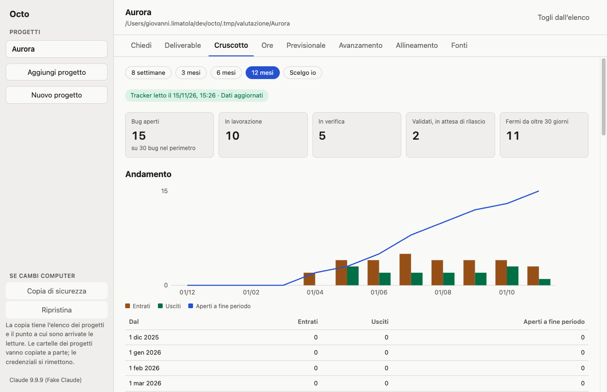 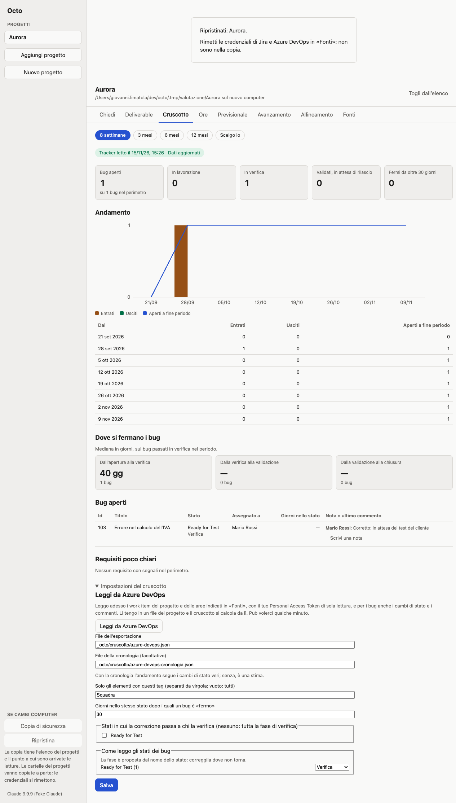

**Giusto così:** è la scheda più riuscita. Periodo a pulsanti, età dei dati in evidenza, cinque numeri, grafico, tabelle. Le impostazioni usano già caselle e menu per periodi, stati e fasi.

**Da sistemare.**
- **Vuoto:** due sezioni («Leggi da Azure DevOps» e «Da dove leggo bug e requisiti») con il testo «la leggo io da Azure DevOps qui sotto» mentre il pulsante è sopra. Se Azure DevOps non è collegato, il pulsante risponde «Questa fonte non è ancora configurata». Proposta: un'azione sola, «Leggi da Azure DevOps», che se la fonte manca porta a collegarla; «Ho già un file di esportazione» come alternativa secondaria.
- **«Leggi da Azure DevOps» sparisce dentro le impostazioni** una volta configurato: per aggiornare i dati (l'azione di ogni settimana) bisogna scendere in fondo e aprire «Impostazioni del cruscotto». Va accanto a «Tracker letto il…», in alto.
- **«Solo gli elementi con questi tag (separati da virgola; vuoto: tutti)»**: testo libero, mentre i tag sono nel file letto. Caselle.
- **La tabella dell'andamento ripete il grafico** e con 12 mesi a passo settimanale sono 52 righe prima di arrivare ai bug aperti, che sono la cosa su cui si agisce. Chiuderla sotto «Mostra i numeri».
- **«Giorni nello stato: —»** per un bug senza cronologia: dire «non noto» con il perché.
- «Scrivi una nota» è testo grigio sotto l'ultimo commento: poco visibile, ed è una delle poche cose che il PM scrive qui.

### 4.5 Ore

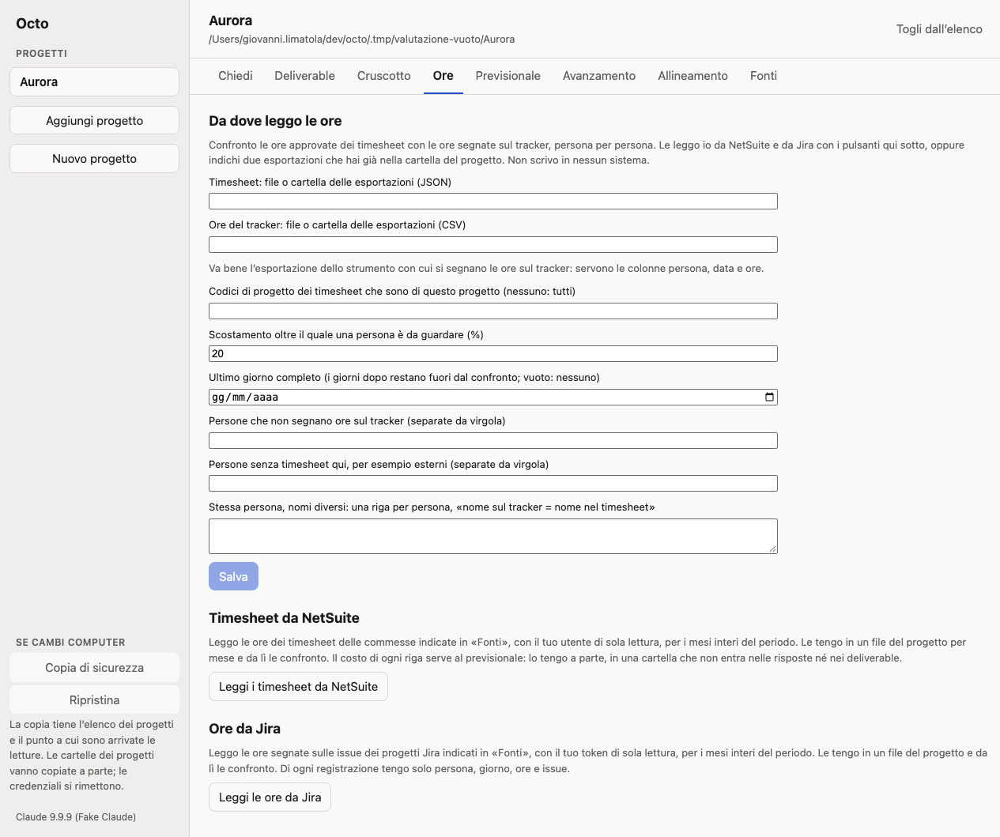 

**Percorso alla prima volta.** La scheda si apre su otto campi («Da dove leggo le ore») con «Salva» disattivato; sotto, due sezioni con i pulsanti che fanno il lavoro da soli («Leggi i timesheet da NetSuite», «Leggi le ore da Jira»). Il PM non sa se deve compilare, premere, o tutte e due le cose, né in che ordine. La risposta giusta (premere i due pulsanti: i percorsi si compilano da soli) è la meno visibile.

**Da sistemare.**
- **Ordine rovesciato:** prima le due letture, come passi 1 e 2 con il loro stato («Timesheet: letti ottobre 2026, 664 ore»); i percorsi a mano sotto «Ho già le esportazioni».
- **Le due letture dipendono dal periodo scelto in alto**, ma a scheda non configurata il periodo non c'è: non si sa quali mesi verranno letti.
- **Tre campi per il periodo** («Mese», «Dal», «Al») senza spazio dalle etichette; cambiando «Dal» il mese si svuota. Proposta: un selettore del mese con frecce ‹ › e «Altro periodo…» per le due date.
- **Persone in campi di testo:** «Persone che non segnano ore sul tracker (separate da virgola)», «Persone senza timesheet qui», «nome sul tracker = nome nel timesheet». Octo conosce tutti i nomi dai due file: selezione multipla e coppie scelte da due menu. «È atteso» nella tabella è la strada giusta ma non ha ritorno (§2.7).
- **«Codici di progetto… (nessuno: tutti)»** con sotto «Codici trovati nel periodo: PRJ000101, PRJ000999» come testo: sono caselle già pronte.
- **«Rimasto fuori dal confronto»** è un elenco a punti in fondo; «8 ore sul codice PRJ000999, che non è fra quelli del progetto» meriterebbe l'azione accanto («Aggiungi al progetto»).
- La pillola «Quadratura: 664 ore approvate, tutte nel confronto» è un buon riscontro: giusto.

### 4.6 Previsionale

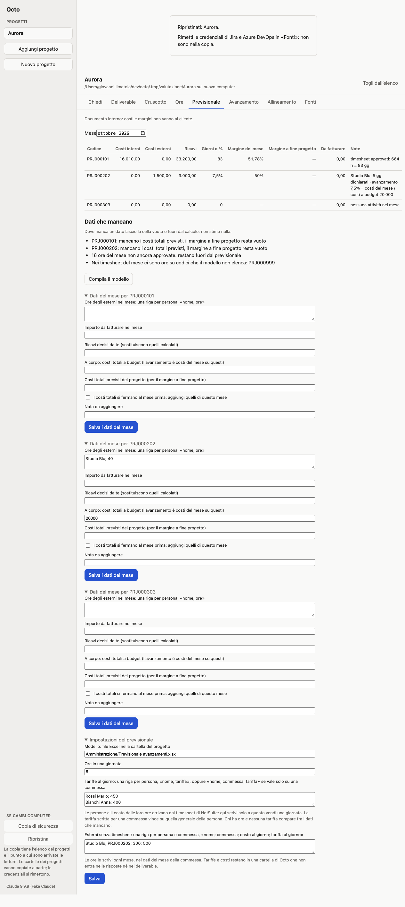

**Percorso alla prima volta.** Scegliere il modello (percorso a mano), scrivere le tariffe (righe con `;`), poi per ogni codice aprire «Dati del mese per PRJ…» e compilare sei campi, salvare ciascuno con il suo «Salva i dati del mese», infine «Compila il modello». Con tre codici: tre moduli identici impilati e quattro pulsanti di salvataggio.

**Da sistemare.**
- **L'azione principale («Compila il modello») è un pulsante bianco in mezzo alla pagina**, fra «Dati che mancano» e i moduli dei codici.
- **I dati del mese sono separati dalla tabella che li mostra.** La tabella in alto ha già una riga per codice: «Da fatturare», «Ricavi», «Note» dovrebbero modificarsi lì, nella riga, con un salvataggio solo.
- **«Dati che mancano» è un elenco di testo.** Ogni voce ha un rimedio preciso: «manca la tariffa al giorno di Rossi Mario» → campo per scriverla lì; «mancano i costi totali previsti» → idem.
- **Tariffe:** le persone arrivano dai timesheet (lo dice l'aiuto), ma vanno riscritte per nome. Una tabella con le persone già elencate e la colonna «Tariffa al giorno» vuota da riempire; «Aggiungi una tariffa per commessa» per le eccezioni.
- **Esterni:** la commessa è testo libero, mentre i codici sono quelli del modello: menu.
- **Etichette lunghe e ambigue:** «A corpo: costi totali a budget (l'avanzamento è costi del mese su questi)»; la casella «I costi totali si fermano al mese prima: aggiungi quelli di questo mese» non si capisce senza conoscere il calcolo.
- **«Giorni o %»** è una colonna con due unità secondo la riga: scrivere l'unità nella cella («83 gg», «7,5%»).
- **«Mese» senza frecce** e attaccato all'etichetta. A 900 px la tabella esce dalla finestra.
- «Documento interno: costi e margini non vanno al cliente» è un avviso utile reso come nota grigia: dargli il peso di un avviso.

### 4.7 Avanzamento: flusso ridisegnato

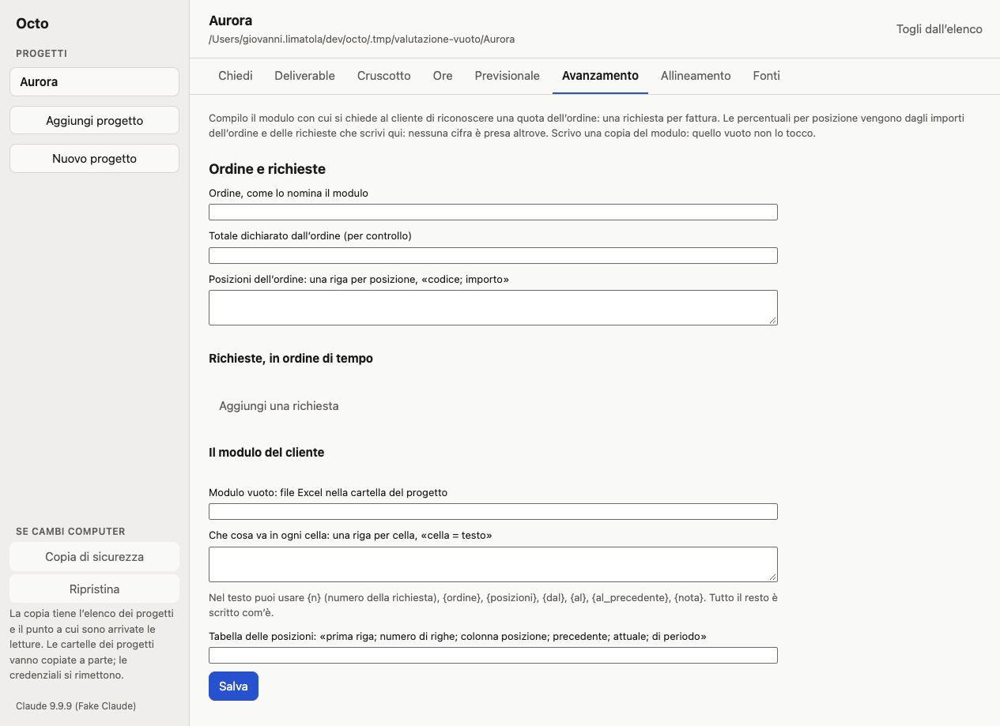 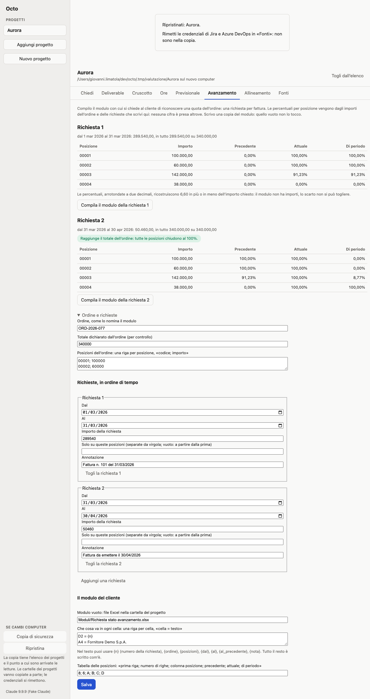

**Com'è oggi.** Un solo modulo con tre parti in quest'ordine: ordine e posizioni, richieste, modulo del cliente. Un solo «Salva» in fondo. Per arrivare al primo risultato servono, contando dal copione della demo 10: 3 campi dell'ordine, 4 campi della richiesta, 3 campi del modulo, «Salva», poi «Compila il modulo della richiesta 1», poi «Apri il file».

**Dove ci si blocca.**
1. **L'ordine di compilazione è rovesciato rispetto alla frequenza.** In alto ciò che si scrive una volta per ordine, in mezzo ciò che si fa ogni mese, in fondo ciò che si fa una volta per cliente. Ma senza l'ultima parte non si compila nulla, e l'errore («Indica il file Excel del modulo vuoto») arriva solo premendo «Compila».
2. **La mappa delle celle è il punto più difficile dell'app.** «D2 = {n}», «A4 = Fornitore Demo S.p.A.», sette segnaposto fra graffe da ricordare, e la tabella «8; 6; A; B; C; D». Per scriverla bisogna aprire Excel, leggere le coordinate e trascriverle. Un errore di cella non si vede finché non si apre il file compilato. Il copione della demo lo salta: «sono già impostati».
3. **Posizioni come righe «codice; importo»**, con righe sbagliate scartate in silenzio (§2.2).
4. **Aggiungere la richiesta del mese** (l'azione ricorrente) richiede: aprire «Ordine e richieste», scorrere oltre le richieste passate, «Aggiungi una richiesta» (testo grigio), compilare, scorrere fino a «Salva» in fondo, oltre il modulo del cliente.
5. **«Solo su queste posizioni (separate da virgola; vuoto: a partire dalla prima)»**: i codici sono tre righe più su e vanno riscritti.
6. **Le richieste passate restano modificabili** come quella nuova: cambiare un importo di marzo ricalcola tutto ciò che viene dopo, senza avviso.
7. **Dopo un errore il modulo si richiude** e resta l'elenco degli avvisi (§2.3). 
8. **Lo scarto di arrotondamento** («ricostruiscono 6,60 in più o in meno… lo scarto non si può togliere») è spiegato bene ma compare come nota grigia sotto ogni tabella, alla pari del resto.

**Flusso proposto, passo per passo.**

*Prima volta (tre passi guidati, con «1 · 2 · 3» in alto e lo stato di ciascuno).*

1. **Il modulo del cliente.** «Scegli il modulo Excel vuoto…» con la finestra del sistema. Octo mostra l'anteprima del foglio (celle con il loro testo, in sola lettura).
2. **Che cosa va dove.** Per ogni dato che Octo sa scrivere c'è una riga: «Numero della richiesta», «Ordine e posizioni», «Dal», «Al», «Annotazione», e la tabella («Prima riga delle posizioni», colonne «Posizione», «Precedente», «Attuale», «Di periodo»). Il PM fa clic sulla riga e poi sulla cella nell'anteprima: la coordinata si scrive da sola. I testi fissi («Fornitore Demo S.p.A.») sono righe «testo libero → cella». Chi preferisce può ancora scrivere `D2` a mano. In fondo: «Prova su una copia», che compila un file di esempio e lo apre.
   - *Versione ridotta, senza anteprima:* le stesse righe con un campo «cella» ciascuna (niente graffe, niente `=`), e «Prova su una copia». Costa molto meno e toglie già il linguaggio.
3. **L'ordine.** Numero d'ordine, e una tabella «Posizione | Importo» con «Aggiungi posizione»; il totale si somma sotto la tabella e si confronta con «Totale dichiarato» mentre si scrive.

Fatti i tre passi, non si vedono più: restano dietro «Impostazioni» in alto a destra.

*Ogni mese (la pagina normale).*

4. **In alto, una riga di sintesi:** «Ordine ORD-2026-077 · 340.000,00 € · chiesto finora 289.540,00 € (85%) · restano 50.460,00 €», con una barra.
5. **Un pulsante principale: «Nuova richiesta».** Apre un riquadro con: «Dal» (già uguale all'«Al» della precedente), «Al», «Importo» (con «Tutto il residuo: 50.460,00» come scorciatoia), «Fattura di riferimento», e «Su quali posizioni»: «In ordine, dalla prima non chiusa» (predefinito) oppure caselle con i codici e il residuo di ciascuna.
6. **Mentre si scrive l'importo, sotto compare l'anteprima** delle percentuali per posizione. Un importo oltre il residuo si segnala lì, accanto al campo, prima di salvare.
7. **«Salva e compila il modulo»** fa le due cose; alla riuscita: «Modulo della richiesta 2 pronto», con «Apri il file» e «Mostra nella cartella» come pulsanti veri.
8. **Sotto, lo storico:** una riga per richiesta (numero, periodo, importo, cumulato, file), che si apre per vedere le percentuali. Le richieste passate sono in sola lettura; «Correggi» le sblocca dicendo che quelle successive verranno ricalcolate e i loro moduli vanno ricompilati.
9. **Lo scarto di arrotondamento** compare solo dove esiste, come nota nel dettaglio della richiesta.

Che cosa serve fuori dall'interfaccia: per il passo 2 completo, una lettura delle celle del modulo (oggi l'interfaccia riceve solo l'elenco dei file candidati); per la versione ridotta, niente. «Prova su una copia» può usare la compilazione che c'è già.

### 4.8 Allineamento

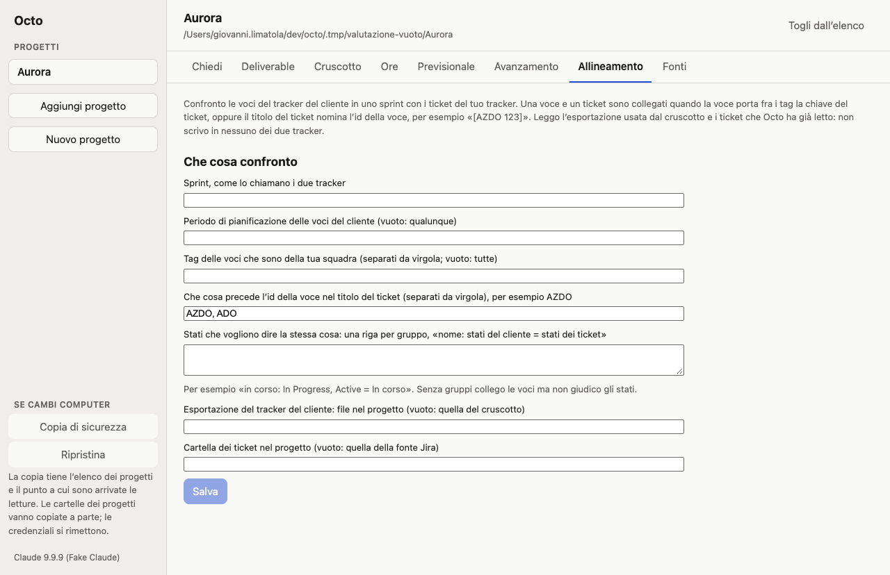 

**Da sistemare.**
- **L'introduzione è un paragrafo di regole** («…quando la voce porta fra i tag la chiave del ticket, oppure il titolo del ticket nomina l'id della voce, per esempio «[AZDO 123]»»): corretta, ma è la prima cosa che si legge e resta sempre lì. Va in «Come collego voci e ticket», chiuso.
- **Lo sprint è l'unica cosa che cambia a ogni uso** ed è il primo campo delle impostazioni, in fondo alla pagina. Va in alto come selettore, con gli sprint letti dai due tracker (oggi sono un `datalist`, che compare solo dopo la prima lettura riuscita: la prima volta lo sprint si scrive a memoria, esatto).
- **Primo salvataggio senza dati:** «Indica il file di esportazione del tracker del cliente, qui o nella scheda «Cruscotto»», senza collegamento.
- **«Stati che vogliono dire la stessa cosa»**: righe «nome: stati del cliente = stati dei ticket». Gli stati dei due lati sono noti: due colonne di caselle per gruppo, oppure trascinare.
- **Tag, periodo, prefissi:** testo libero dove i valori sono nei file (§5).
- **Sette tabelle con lo stesso peso.** Quelle che chiedono un'azione («Senza ticket», «Ticket da spostare») sono giustamente in alto; le altre («Collegate», «Voci con più di un ticket», «Ticket dello sprint senza riferimento») andrebbero chiuse con il loro conteggio. La frase di sintesi («6 voci… 3… 1… 2…») è buona: farne tre numeri grandi come nel Cruscotto.
- **«Scrivi il file di import dei ticket mancanti»** è l'azione che conclude il lavoro ed è un pulsante bianco fra due tabelle.
- **«Stato cliente → stato ticket»** e la colonna «Stati» («Coerenti/Diversi») dicono la stessa cosa in due colonne.

---

## 5. Campi da trasformare

«Già noto» vuol dire che il valore è in un file che Octo ha letto o in un'altra impostazione; se oggi l'interfaccia non lo riceve, l'ultima colonna lo dice.

| Campo | Scheda | Oggi | Dovrebbe diventare | Da dove prende i valori |
|---|---|---|---|---|
| Elenco dei progetti | barra | pulsanti in colonna | selettore con elenco | registro dei progetti (c'è) |
| File dell'esportazione, cronologia | Cruscotto | testo + `datalist` | «Scegli il file…» + elenco dei trovati | candidati (c'è) + finestra del sistema |
| Solo gli elementi con questi tag | Cruscotto | testo, virgole | caselle | tag dell'esportazione (da esporre) |
| Giorni per «fermo» | Cruscotto | numero | numero: giusto | — |
| Periodi da controllare, stati di passaggio, fasi | Cruscotto | caselle e menu | giusto così | vista del cruscotto |
| Mese / Dal / Al | Ore | tre campi | selettore del mese con ‹ › + «Altro periodo» | — |
| Timesheet, ore del tracker (percorsi) | Ore | testo + `datalist` | stato delle due letture + «Scegli…» | candidati (c'è) |
| Codici di progetto dei timesheet | Ore | testo, virgole | caselle | «Codici trovati nel periodo» (c'è) e codici commessa di NetSuite in Fonti |
| Persone che non segnano sul tracker | Ore | testo, virgole | selezione multipla | persone dei timesheet (c'è nelle righe) |
| Persone senza timesheet | Ore | testo, virgole | selezione multipla | persone del tracker (c'è nelle righe) |
| Stessa persona, nomi diversi | Ore | righe «a = b» | coppie da due menu | persone dei due lati (c'è nelle righe) |
| Ultimo giorno completo | Ore | data | data: giusto, etichetta più corta | — |
| Mese | Previsionale | campo mese | selettore con ‹ › | mesi con timesheet (da esporre) |
| Modello (percorso) | Previsionale | testo + `datalist` | «Scegli il file…» | candidati (c'è) |
| Tariffe al giorno | Previsionale | righe «nome; tariffa» / «nome; commessa; tariffa» | tabella con le persone già elencate | persone dei timesheet (da esporre); commesse dal modello (c'è nelle righe) |
| Esterni senza timesheet | Previsionale | righe «nome; commessa; costo; tariffa» | tabella; commessa a menu | codici del modello (c'è) |
| Ore degli esterni nel mese | Previsionale | righe «nome; ore» | una riga per esterno già dichiarato, solo le ore da scrivere | esterni delle impostazioni (c'è) |
| Da fatturare, ricavi, costi, nota | Previsionale | modulo separato per codice | celle modificabili nella riga della tabella | — |
| Posizioni dell'ordine | Avanzamento | righe «codice; importo» | tabella Posizione/Importo | — (in futuro dal PDF dell'ordine) |
| Totale dichiarato, importo della richiesta | Avanzamento | testo | campo importo in euro | residuo calcolato come scorciatoia |
| Solo su queste posizioni | Avanzamento | testo, virgole | caselle con il residuo | posizioni dell'ordine (c'è) |
| Modulo vuoto (percorso) | Avanzamento | testo + `datalist` | «Scegli il file…» | candidati (c'è) |
| Che cosa va in ogni cella | Avanzamento | righe «cella = testo» con `{…}` | una riga per dato con campo «cella» (o clic sull'anteprima) | celle del modulo (da esporre, solo per l'anteprima) |
| Tabella delle posizioni | Avanzamento | «8; 6; A; B; C; D» | sei campi con nome | idem |
| Sprint | Allineamento | testo + `datalist` | menu in alto | sprint dei due tracker (c'è dopo la prima lettura; da esporre prima) |
| Periodo di pianificazione | Allineamento | testo | menu | periodi dell'esportazione (c'è nel Cruscotto) |
| Tag della tua squadra | Allineamento | testo, virgole | caselle | tag dell'esportazione (da esporre) |
| Che cosa precede l'id nel titolo | Allineamento | testo, virgole | proposta automatica + conferma | prefissi trovati nei titoli dei ticket (da calcolare) |
| Stati che vogliono dire la stessa cosa | Allineamento | righe «nome: a, b = c» | gruppi con due colonne di caselle | stati dei due tracker (da esporre) |
| Esportazione, cartella dei ticket | Allineamento | testo | «Scegli…», sotto «Avanzate» | — |
| Parole chiave, mittenti esclusi | Fonti · Posta | area, una per riga | elenco di etichette con «+» | mittenti e domini dall'anteprima (c'è in parte) |
| Cartelle di posta | Fonti · Posta | area, una per riga | caselle | cartelle di Mail (da esporre) |
| Aree, progetti | Fonti · ADO, Jira | area + pulsanti dopo «Cerca» | caselle dall'elenco cercato | «Cerca progetti e aree» (c'è) |
| Codici commessa | Fonti · NetSuite | area, una per riga | elenco di etichette con controllo «PRJ + 6 cifre» mentre si scrive | restano a mano (scelta della roadmap) |
| Cartella nel progetto | Fonti · tutte | testo | nascosto sotto «Avanzate» | valore proposto (c'è) |
| Persone | Fonti | righe con 6 valori e `;` | tabella: nome, ruolo, parte (menu nostra/cliente), dal, al (date), come scrivergli | nomi da timesheet e tracker come suggerimento (da esporre) |
| Calendario | Fonti | righe «nome; dal; al» | tabella con due date | sprint e periodi dei tracker come suggerimento (da esporre) |
| Domande di un tipo tuo | Deliverable | righe, `*` se obbligatoria | una riga per domanda + casella «obbligatoria» | — |
| Chi lo legge | Deliverable | menu | giusto così | — |
| Modelli di Claude | Fonti | tre menu | giusto così, ma in «Avanzate» | — |

---

## 6. Regole grafiche minime

Si applicano a `styles.css` e alle classi già usate; non richiedono di riscrivere le viste.

**Colori.** Tenere i dieci di oggi e aggiungere:
- `--danger` e `--danger-bg` (rosso): errori che bloccano e azioni distruttive. `--warning` resta per ciò che si può ignorare.
- `--field-line`: bordo dei campi più scuro di `--line` (almeno 3:1 sul fondo).
- `--accent-text`: colore del testo sul blu, da definire anche per il tema scuro (oggi bianco su azzurro chiaro: 2,4:1).
- Disattivato: non l'opacità al 50% ma un grigio con contrasto almeno 3:1.

**Spaziature.** Oggi 20 valori diversi. Una scala sola: 4, 8, 12, 16, 24, 32. Regole: 4 fra etichetta e campo; 12 fra un campo e il successivo; 24 fra gruppi di campi; 32 fra sezioni; margine della pagina 24 ovunque, senza rientri in più.

**Tipografia.** Oggi nove misure (11–24 px). Quattro: 13 (aiuti, note, intestazioni di tabella), 15 (testo, campi, pulsanti), 17 (titolo di sezione), 20 (titolo di pagina). Niente testo sotto i 13. Larghezza massima dei testi 720 px; le tabelle possono allargarsi.

**Pagina.** Ogni scheda ha la stessa struttura: titolo e una riga di descrizione; a destra «Impostazioni»; sotto, la riga dei controlli (periodo, sprint, età dei dati); poi i risultati. Le impostazioni si aprono sempre nello stesso modo (pannello o pagina), mai come `details` in fondo.

**Pulsanti: quattro tipi.**
- *Principale* (blu pieno): uno per vista, l'azione per cui si è lì («Compila il modello», «Scrivi la bozza», «Nuova richiesta»). Assegnato con una classe, non con `type="submit"`.
- *Secondario* (bordo): tutte le altre azioni.
- *Di testo* (blu, senza bordo, sottolineato al passaggio): azioni dentro righe e note («Apri il file», «È atteso»). Mai grigio.
- *Distruttivo* (testo rosso; rosso pieno solo nella conferma).
Altezza unica 32 px; nei gruppi il principale sta sempre a sinistra.

**Campi.** Un solo stile, quello di `.source-form` esteso a ogni `input`, `select`, `textarea` dell'app: altezza 32–36, raggio 8, bordo `--field-line`, fuoco con lo stesso contorno blu di 2 px per tutti. Etichetta sopra, 13–15 px in grassetto leggero; aiuto sotto in grigio; errore sotto in rosso al posto dell'aiuto. Larghezza secondo il contenuto: date e importi 160 px, nomi 320, percorsi e testi 100% fino a 720. Mai etichetta e campo sulla stessa riga senza spazio.

**Componenti da avere una volta sola** (oggi ognuno è rifatto in ogni vista):
- *Avviso*: quattro varianti (informazione, riuscita, attenzione, errore), con «×», e azione facoltativa.
- *Conferma di salvataggio*: accanto al pulsante, sparisce da sola.
- *Attesa*: segno animato + testo + «Ferma» facoltativo.
- *Tabella modificabile*: righe con campi tipizzati, «Aggiungi riga», «Togli». Sostituisce i campi a righe.
- *Scelta di file*: pulsante + nome del file + «Cambia».
- *Selezione da valori noti*: caselle fino a 8 valori, menu con ricerca oltre.
- *Dialogo di conferma*: per le azioni di §2.7.
- *Stato vuoto*: una frase, un'azione principale.
- *Pillola di stato*: quattro colori, sempre con testo.

**Tabelle.** Intestazione che resta in vista scorrendo; riga evidenziata al passaggio; numeri a destra con cifre a larghezza fissa (`font-variant-numeric: tabular-nums`); riga «da guardare» con fondo `--warning-bg`; sotto i 1000 px scorrimento orizzontale dentro la tabella, non della finestra.

---

## 7. Piano di intervento

Dal più utile al meno utile. Sforzo: piccolo = fino a un giorno; medio = due-quattro giorni; grande = una settimana o più. I file sono in `apps/desktop/src/renderer/` salvo dove indicato.

| # | Incremento | Che cosa cambia per chi usa l'app | File toccati | Sforzo | Rischi |
|---|---|---|---|---|---|
| 1 | **Progetti: selettore, gestione, «Togli» sicuro, avvisi che si chiudono** | Si capisce dove si cambia progetto; «Togli» non è più a portata di clic, chiede conferma e non fa perdere nulla; la barra si libera; il riquadro del ripristino si chiude | `App.tsx`, `messages.ts`, `styles.css`; fuori: vedi sotto | medio | i test e l'e2e cercano i pulsanti per nome; la scelta A di §3.1 cambia come si riconosce un progetto |
| 2 | **Un solo stile di moduli e pulsanti** (§6: campi, pulsanti, spaziature, fuoco, disattivato) | L'app smette di sembrare grezza; l'azione principale si riconosce | `styles.css`; classi dei pulsanti in ogni `*View.tsx` e `*Section.tsx` | piccolo–medio | solo visivi; da riguardare ogni scheda a 1280 e a 900 |
| 3 | **Niente più righe scartate in silenzio, errori accanto al campo e con il rimedio** | Un dato scritto male viene detto, con la riga; gli errori dicono che cosa manca e dove andare; il modulo non si richiude | `progress-text.ts`, `team-text.ts`, `forecast-text.ts`, `HoursView.tsx`, `AlignmentView.tsx`, `FeedSection.tsx`, `messages.ts` | medio | i lettori di righe oggi tollerano tutto: renderli severi può rifiutare impostazioni già salvate, da leggere comunque senza perdere nulla |
| 4 | **Avanzamento ridisegnato** (§4.7, versione ridotta per la mappa delle celle) | La richiesta del mese si fa in un riquadro con anteprima; ordine e modulo si impostano una volta, a passi; niente graffe | `ProgressView.tsx` (in gran parte riscritto), `progress-text.ts`, `messages.ts`, `styles.css` | grande | è la vista con più logica nel modulo; il formato salvato può restare lo stesso, così non serve migrare |
| 5 | **Impostazioni del progetto al posto di «Fonti»**: elenco delle fonti con stato, collegamento a passi, «Come ottengo il token?» | Collegare una fonte è un percorso con un ordine; una fonte collegata è una riga, non un modulo; la pagina sta in una finestra | `App.tsx`, `SetupGuide.tsx`, `SourcesView.tsx`, `FeedSection.tsx`, `DocumentsSection.tsx`, `TeamSection.tsx`, `ModelsSection.tsx`, `messages.ts` | medio–grande | tocca il primo uso (obiettivo «30 minuti senza aiuto»): da provare con il pilota |
| 6 | **Tabella modificabile e scelta di file come componenti**, applicati a persone, calendario, tariffe, esterni, nomi diversi, posizioni, domande | Spariscono i separatori; date e importi hanno il loro campo; i file si scelgono dalla finestra del sistema | componente nuovo; `TeamSection.tsx`, `ForecastView.tsx`, `HoursView.tsx`, `DeliverablesView.tsx`, `DashboardSettingsForm.tsx`, i `*-text.ts` | medio | i `*-text.ts` restano per leggere il salvato; la scelta di file richiede una voce in più nel ponte |
| 7 | **Selezioni dai valori noti** (§5: tag, sprint, periodi, persone, codici, stati) | Non si riscrive ciò che Octo ha già letto; niente errori di battitura che svuotano un confronto | `DashboardSettingsForm.tsx`, `HoursView.tsx`, `ForecastView.tsx`, `AlignmentView.tsx`; fuori: vedi sotto | medio | dipende dai dati esposti dall'applicazione; un valore salvato che non è più fra i noti va mostrato comunque |
| 8 | **Navigazione a gruppi nella barra laterale** (scelta A di §3.2), impostazioni di ogni scheda in alto, rimandi cliccabili | Lavoro e configurazione separati; niente schede tagliate; le impostazioni sempre nello stesso posto | `App.tsx`, `styles.css`, ogni `*View.tsx` per il pulsante «Impostazioni» | medio | cambia l'abitudine di chi già usa l'app; e2e da aggiornare |
| 9 | **Previsionale: dati del mese nella tabella, «Dati che mancano» con il rimedio accanto** | Un salvataggio solo; si corregge dove si vede il problema | `ForecastView.tsx`, `forecast-text.ts` | medio | celle modificabili in tabella: attenzione a tastiera e fuoco |
| 10 | **Ore, Cruscotto, Allineamento: prime azioni in alto** (letture come passi con stato, sprint e «Leggi da Azure DevOps» in cima, tabelle secondarie chiuse) | La prima volta si capisce che cosa premere; l'aggiornamento settimanale è a un clic | `HoursView.tsx`, `DashboardView.tsx`, `AlignmentView.tsx` | piccolo–medio | bassi |
| 11 | **Attese e stati vuoti**: segno animato, passi, «Ferma», frase e azione negli stati vuoti | Si capisce che l'app sta lavorando e che cosa fare a scheda vuota | componente nuovo; tutte le viste | piccolo | «Ferma» per letture e scrittura dei deliverable richiede l'annullamento fuori dall'interfaccia |
| 12 | **Testi**: glossario, gergo tecnico, etichette corte con aiuto sotto, plurali, nomi delle schede | Stesse parole ovunque; niente «JSON», «CSV», «DWSI» | `messages.ts`, `docs/` | piccolo | l'e2e e i copioni citano le etichette: vanno aggiornati insieme |
| 13 | **Tastiera e finestra piccola**: frecce sulle schede o voci di menu, scorciatoie, aiuti leggibili senza mouse, resa a 900 px, tema scuro | Uso da tastiera completo; niente scorrimento orizzontale | `App.tsx`, `styles.css`, `apps/desktop/src/main/main.ts` (se cambia il minimo) | piccolo | bassi |

**Che cosa richiede modifiche fuori dall'interfaccia.**

| Per l'incremento | Modifica | Dove |
|---|---|---|
| 1 | «Togli» reversibile: non cancellare lo stato delle letture, riconoscere il progetto dalla cartella quando rientra; oppure (scelta B) cancellare anche credenziali e indici | `packages/application/src/projects.ts`, archivio delle credenziali e degli indici in `packages/infrastructure` |
| 1 | «Apri la cartella» del progetto dalla gestione | ponte (`shared/api.ts`, `preload`, processo principale) |
| 3 | Errori distinti: campo mancante per ciascuna fonte, causa precisa per l'avanzamento, fonte non collegata con il suo nome | codici d'errore in `shared/api.ts` e nei casi d'uso |
| 4 (versione completa) | Leggere le celle del modulo Excel per l'anteprima | caso d'uso nuovo + lettura in `packages/infrastructure/src/office` |
| 5 | Stato per fonte in una chiamata sola (collegata, ultima lettura, elementi, errore) | oggi sparso fra `feedingStatus`, `feed`, `mailSource` |
| 6 | Finestra del sistema per scegliere un file dentro la cartella del progetto, che restituisce il percorso relativo | ponte; c'è già per carta intestata e presentazioni |
| 7 | Esporre: tag e tipi dell'esportazione del tracker; persone dei timesheet e del tracker anche a scheda non configurata; stati dei due tracker; sprint prima del primo confronto; mesi con timesheet; cartelle di Mail | casi d'uso di cruscotto, ore, allineamento, posta |
| 11 | Annullare una lettura o una scrittura in corso | casi d'uso di lettura e deliverable (per «Chiedi» c'è già) |

**Dipendenze.** 2 prima di 4, 5, 6 (altrimenti si rifà lo stile due volte). 6 prima di 9 e della parte «tabelle» di 4. 3 può partire subito ed è indipendente. 8 è meglio dopo 5 (che ha già separato le impostazioni).

---

## 8. Che cosa non ho potuto verificare

- **Finestre del sistema** (scelta di cartella e di file, salvataggio della copia): Playwright non le pilota; nell'e2e rispondono da sole. «Aggiungi progetto», «Nuovo progetto», carta intestata e modello delle presentazioni sono giudicati dal codice e dall'esito.
- **Windows.** Solo Mac. Caratteri, campi nativi (data, mese, menu) e barre di scorrimento su Windows sono diversi: i moduli non stilati lì avranno un altro aspetto ancora.
- **Tema scuro.** Non guardato; il contrasto del pulsante principale è calcolato, non visto.
- **Attese reali.** Con il Claude finto e i sistemi finti ogni operazione dura un istante: non ho visto come si vive una bozza di due minuti, una lettura di Azure DevOps di qualche minuto, né che cosa succede cambiando scheda o progetto a metà. Lo stato «in corso» di Chiedi l'ho catturato ma non analizzato a fondo.
- **Volumi veri.** Aurora ha 30 bug, 6 persone, 3 codici, 4 deliverable. Cronologia lunga in Chiedi, decine di deliverable nell'elenco, tabelle da centinaia di righe, nomi lunghi: giudicati dal codice.
- **Deliverable, passo delle domande.** La cattura automatica del modulo di «Email al cliente» e dell'errore a campo vuoto non è riuscita (il mio script non ha trovato il riquadro); il resto del percorso (bozza, revisione, approvazione, registro) l'ho visto nelle schermate dell'e2e, ma stima, presentazione e tipi di testo solo come esito del test, senza guardarle una per una.
- **NetSuite.** La sezione l'ho vista vuota; il collegamento richiede il database di prova (`pnpm db:setup`), che non ho avviato. «Leggi i timesheet da NetSuite» è visto solo nel caso d'errore.
- **«Scollega».** Non premuto: che cosa accade ai file già letti e alla credenziale lo dico dalla roadmap, non dall'app.
- **Permesso sulla posta di macOS** («Accesso completo al disco») e posta su Windows: messaggi letti in `messages.ts`, non visti a schermo.
- **Lettore di schermo.** Ho controllato nomi dei campi, ruoli e ordine del fuoco, non l'ascolto con VoiceOver.
- **Righe scartate in silenzio** per tariffe, esterni, nomi diversi e gruppi di stati: dedotte dal codice per analogia con i due casi provati (persone e posizioni).
- **Il progetto reale.** Per scelta non l'ho aperto: i difetti che dipendono dai suoi dati (nomi degli stati, numero di commesse, lunghezza dei titoli) qui non compaiono.

Gli script di cattura non sono nel repository: stavano nella cartella temporanea della sessione. Le schermate complete sono in `.tmp/valutazione/` (ignorata da git); quelle citate qui sono copiate in `docs/valutazione-interfaccia/`.
